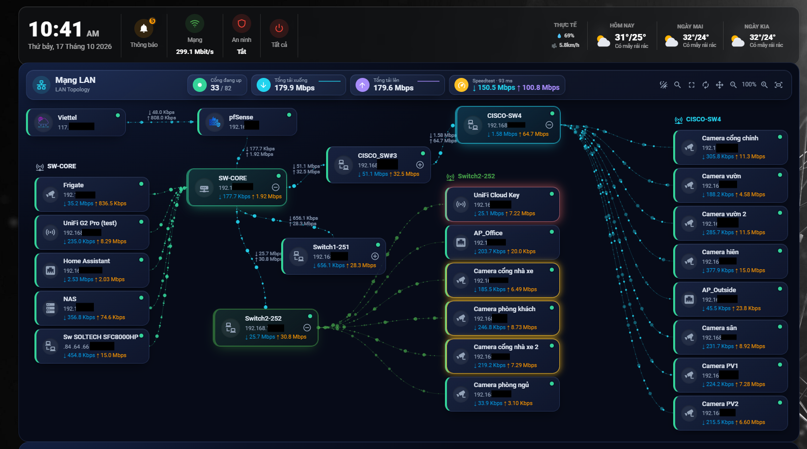

# 🌐 SNMP Topo LAN Card

[](https://github.com/hacs/integration)


> 🇻🇳 **Tiếng Việt (bản chính)** · 🇬🇧 **English version:** [README.en.md](README.en.md)

Card tùy chỉnh cho Home Assistant Lovelace vẽ toàn bộ mạng LAN thành sơ đồ cây trực tiếp: **ISP → pfSense → switch lõi → các switch khác → cổng có thiết bị**. Đường flow chuyển động có tốc độ và độ dày theo băng thông thật, bố cục kéo thả, cảnh báo lưu lượng và trình chỉnh sửa giao diện trực quan.

Dữ liệu lấy từ integration **SNMP Switch Manager**. Với switch yếu không chạy được qua integration, bạn dùng sensor SNMP bằng YAML. **Không cần plugin giao diện bổ sung, cấu hình hoàn toàn qua trình chỉnh sửa tích hợp.**

> 📌 **Quy ước trong tài liệu:** địa chỉ IP ghi chung là `192.168.1.x` (thay `x` bằng IP thật của thiết bị). Chuỗi community ghi là `<COMMUNITY>` và chỉ lưu trong `secrets.yaml`. Tên switch trong ví dụ: `SW-CORE`, `Switch1-251`, `Switch2-252`, `SF220`.

---

## 📸 Xem trước



## 🎛️ Visual Config Editor


---

## ✨ Tính năng (v1.0.0)

### 🎨 Hiển thị & giao diện
- 🌳 **Sơ đồ cây** ISP → pfSense → switch lõi → switch con → cổng có thiết bị, vẽ ngang (`horizontal`) hoặc dọc (`vertical`)
- ✨ **Đường flow chuyển động** kiểu `dash` hoặc `galaxy`, độ dày, tốc độ và độ sáng theo băng thông; đường nhàn rỗi đứng yên cho nhẹ máy
- 🏷️ **Nhãn đường nối** `↓ ↑` hiện tốc độ trên mọi đường nối giữa các switch
- 🌗 **Glass / Neon**: Glass theo theme HA (sáng/tối), Neon là bảng màu tối cố định, đổi nhanh bằng một nút ở header
- 🪟 **Độ đặc & độ mờ node** để đường flow không lộ xuyên qua chữ
- 📊 **Thống kê header**: số cổng up, tổng tải xuống/lên kèm biểu đồ nhỏ, kết quả **Speedtest** mới nhất
- 🔍 **Tìm kiếm** cổng theo tên, IP hoặc số cổng; 🔎 **Zoom & toàn màn hình**

### 🧩 Bố cục tự do
- ✋ **Kéo thả mọi thứ** (ISP, pfSense, switch lõi, mọi switch) trong chế độ sắp xếp `✥`
- 📌 **Ghim cột thiết bị** bằng cách kéo tiêu đề cột; cột ghim hoạt động độc lập
- 🖧 **Cột switch lõi độc lập**, mở đóng riêng
- ➡️ **Đường flow vào cổng từ cạnh bên**, không chạy xuyên các khối khác
- 💾 **Lưu theo người dùng HA** (đồng bộ giữa thiết bị, có `localStorage` dự phòng); bố cục ngang và dọc lưu riêng
- ↩️ **Đặt lại một cú bấm**; bấm đúp tiêu đề cột để bỏ ghim

### 🔌 Cổng thông minh
- 🤖 **Danh sách thiết bị tự động**: chỉ hiện cổng có link và có lưu lượng, cổng nối giữa các switch tự ẩn
- 🏷️ **Đặt tên từ mô tả cổng**: mô tả `FRIGATE-192.168.1.x` tự tách thành tên + IP
- ✏️ **Đặt tên thủ công** bằng `port_names`, có ô nhập sẵn trong editor
- 🙈 Ẩn switch/cổng, sắp xếp theo cổng/tên/lưu lượng, giới hạn số cổng mỗi switch
- 🔄 Mở tối đa 3 switch cùng lúc, hoặc **tự động xoay** qua từng switch

### 🔔 Cảnh báo lưu lượng
- 🟡🔴 **Glow vàng/đỏ** khi lưu lượng vượt cả mức sàn của tầng **và** trung bình hôm qua nhân hệ số
- 🛡️ **Không báo ảo**: thiết bị nhỏ chỉ sáng khi vượt mức sàn, hết lưu lượng lớn là tắt ngay

### 🎛️ Trình chỉnh sửa trực quan
Entity picker cho ISP/WAN/pfSense/Speedtest, trình soạn đường nối, thanh trượt độ đặc/độ mờ/zoom/chiều cao/ngưỡng cảnh báo, các phần accordion.

---

## 📋 Yêu cầu

| | |
|---|---|
| Home Assistant | 2024.6+ |
| Integration | **[SNMP Switch Manager](https://github.com/OtisPresley/snmp-switch-manager)** (qua HACS), đã bật **Bandwidth Collection**. Switch yếu có thể thay bằng sensor YAML |
| Tài khoản | **Administrator**, vì card đọc registry thiết bị và entity |
| pfSense | Tùy chọn: trạng thái ISP, tốc độ WAN, CPU/RAM/state |
| Speedtest.net | Tùy chọn: ô Speedtest ở header |
| Recorder | Tùy chọn: dùng cho "trung bình hôm qua" trong cảnh báo |

---

## 📦 Cài đặt card

### Cách 1: HACS (khuyến nghị)

1. Thêm Custom Repository:

   [](https://my.home-assistant.io/redirect/hacs_repository/?owner=doanlong1412&repository=snmp-topo-lan-card&category=plugin)

   Nếu nút không hoạt động: **HACS → Frontend → ⋮ → Custom repositories** → URL `https://github.com/doanlong1412/snmp-topo-lan-card` → Type **Dashboard** → Add.
2. Tìm **SNMP Topo LAN** → **Install**.
3. Hard-reload trình duyệt (`Ctrl+Shift+R`).

### Cách 2: Thủ công

1. Tải [`snmp-topo-lan-card.js`](https://github.com/doanlong1412/snmp-topo-lan-card/releases/latest).
2. Chép vào `/config/www/community/snmp-topo-lan-card/snmp-topo-lan-card.js`.
3. **Settings → Dashboards → Resources → Add resource**:
   ```
   URL:  /local/community/snmp-topo-lan-card/snmp-topo-lan-card.js?v=1.0.0
   Type: JavaScript module
   ```
4. Hard-reload trình duyệt. Đổi số sau `?v=` mỗi khi thay file để tránh cache.

---

## 🛠️ Chuẩn bị dữ liệu

Luồng dữ liệu: **Switch (SNMP chỉ đọc) → SNMP Switch Manager (hoặc sensor YAML) → entity trong HA → card**.

### Bước 1: Bật SNMP chỉ đọc trên từng switch

Dùng SNMP v2c, community **chỉ đọc (RO)**, giới hạn theo IP của Home Assistant. Không bao giờ đặt RW để không ai bấm nhầm tắt cổng.

**Cisco IOS (ví dụ `SW-CORE`):**

```
ip access-list standard SNMP-HA
 permit host 192.168.1.x        ! IP của Home Assistant
 deny any
snmp-server community <COMMUNITY> RO SNMP-HA
snmp-server ifindex persist
end
write memory
```

`snmp-server ifindex persist` giữ ifIndex không đổi sau khi khởi động lại.

**TP-Link SG2210P:** giao diện web, SYSTEM → SNMP: bật SNMP, tạo community **Read-only**, bấm **Apply** rồi **Save**. Quên Save là lỗi hay gặp nhất (switch không trả lời).

**Cisco SF220 và hãng khác:** bật dịch vụ SNMP trên giao diện web, tạo community Read-only, đặt management station là IP của Home Assistant, lưu cấu hình vào startup.

Lưu community vào `secrets.yaml`, không dán vào ảnh chụp màn hình hay issue công khai:

```yaml
# secrets.yaml
snmp_swpoe_community: "<COMMUNITY>"
```

**Kiểm tra switch đã trả lời** (từ terminal HA hoặc máy có `snmpwalk`):

```bash
snmpwalk -v2c -c '<COMMUNITY>' 192.168.1.x 1.3.6.1.2.1.31.1.1.1.1
```

- Ra danh sách cổng: switch ổn.
- `Timeout`: community chưa Apply/Save, SNMP đang tắt, hoặc ACL không cho IP của HA.

Lệnh này cũng cho biết **ifIndex** của từng cổng (số ở cuối OID). Luôn lấy ifIndex bằng `snmpwalk`, đừng đoán.

---

### Bước 2: Thêm switch vào integration SNMP Switch Manager

1. **HACS** → thêm `https://github.com/OtisPresley/snmp-switch-manager` → Download → khởi động lại Home Assistant.
2. **Settings → Devices & Services → Add Integration → SNMP Switch Manager** → nhập IP và community, chọn **SNMP v2c**, Submit.
3. Chờ khoảng 1 phút, mở thiết bị và xem mục **Controls** để biết tên cổng hiển thị (cần cho include rule và cho phần map tên).
4. **Configure → Bandwidth Sensors** (làm cho từng switch):

| Tùy chọn | Giá trị |
|---|---|
| Enable Bandwidth Collection | ✅ Bật |
| Bandwidth Data As | **Sensors (history)** |
| Poll Interval | `30` giây |

5. **Include rules**: Action **Add**, Existing rule để trống, Match **Starts with**, nhập Value, Submit. Không tích "Go back (discard changes)".

| Switch | Số rule | Value |
|---|---|---|
| `SW-CORE` (Cisco C1000) | 1 | `Gi1/0/` |
| `SF220` | 2 | `FastEthernet` và `GigabitEthernet` |
| `Switch1-251`, `Switch2-252` (SG2210P) | 1 mỗi con | `gigabitEthernet` |

> ⚠️ Value phải khớp **tên hiển thị** ở mục *Controls*, không phải tên lấy từ `snmpwalk`. Match không phân biệt hoa thường. Nếu rule không ra sensor nào, đổi Match sang **Contains** với `1/0/` (SG2210P) hoặc `Ethernet` (SF220).

6. **Kiểm tra**: chờ 1 đến 2 phút (Throughput ban đầu là `Unknown` vì cần hai lần đọc). Mục **Diagnostic** của thiết bị có 4 sensor mỗi cổng: RX/TX Throughput (bit/s) và RX/TX Total. Nếu đã có sensor YAML đo cùng uplink, nhân giá trị YAML (byte/s) với 8 rồi đối chiếu, khớp trong vài phần trăm là đúng.

**Đổi community sau này:** nếu đổi trên switch mà integration còn giữ chuỗi cũ thì switch bỏ qua truy vấn. Vào **Configure → Connection & Name → SNMP v2c → SNMP Community Override**, điền chuỗi mới, Submit, chờ khoảng 1 phút. Nếu Configure bị mờ hoặc báo lỗi, xóa mục rồi thêm lại bằng IP và community mới.

---

### Bước 3: Giữ nguyên các entity cổng `switch.*`

Card đọc tên cổng và trạng thái link từ các entity này.

- ✅ Muốn dashboard gọn thì **Hide**: Settings → Devices & Services → Entities → lọc `switch.` → chọn tất cả → **Hide selected**.
- ❌ **Không Disable**, nếu không card mất tên cổng và trạng thái link.

---

### Bước 4: Gán nhãn cổng *(tùy chọn nhưng khuyến nghị)*

Đặt cho mỗi cổng có thiết bị một mô tả dạng `TÊN-IP`, card tự hiện tên và IP:

```
interface Gi1/0/6
 description FRIGATE-192.168.1.x
interface Gi1/0/11
 description HASS-192.168.1.x
interface Gi1/0/12
 description NAS-192.168.1.x
```

Cổng còn mô tả mặc định (ví dụ `GigabitEthernet1/0/6`) coi như chưa đặt tên. Switch không cho đặt mô tả thì dùng `port_names` (xem phần **Đặt tên cổng**).

**Tra thiết bị đang cắm ở cổng nào:** lấy MAC theo cổng (SG2210P: SWITCHING → MAC Address → Address Table; Cisco: `show mac address-table`), đối chiếu với bảng DHCP leases của pfSense để ra IP, rồi ghi thành bảng (cổng, MAC, IP, tên).

---

### 🔧 Khi integration lỗi hoặc timeout: dùng sensor YAML

Một số switch nhỏ (ví dụ SG2210P) có agent SNMP yếu, không đáp ứng nổi số truy vấn của integration nên timeout hoặc Configure lỗi. Khi đó đọc trực tiếp từng cổng bằng sensor SNMP thường. Có thể trộn: switch mạnh dùng integration, switch yếu dùng YAML.

**Mẫu cho một cổng (5 entity).** Thay `<TEN>` (ví dụ `swpoe1_p3`), `<IP>`, `<IFINDEX>`:

```yaml
# configuration.yaml → sensor:
  - {platform: snmp, name: <TEN>_in_bytes,  host: <IP>, community: !secret snmp_swpoe_community, version: 2c, baseoid: 1.3.6.1.2.1.31.1.1.1.6.<IFINDEX>,  unit_of_measurement: B, scan_interval: 30, accept_errors: true}
  - {platform: snmp, name: <TEN>_out_bytes, host: <IP>, community: !secret snmp_swpoe_community, version: 2c, baseoid: 1.3.6.1.2.1.31.1.1.1.10.<IFINDEX>, unit_of_measurement: B, scan_interval: 30, accept_errors: true}
  - {platform: snmp, name: <TEN>_status,    host: <IP>, community: !secret snmp_swpoe_community, version: 2c, baseoid: 1.3.6.1.2.1.2.2.1.8.<IFINDEX>,       scan_interval: 60, accept_errors: true}
  - {platform: derivative, name: <TEN>_in_rate,  unique_id: <TEN>_in_rate,  source: sensor.<TEN>_in_bytes,  unit_time: s, time_window: "00:01:00", round: 0}
  - {platform: derivative, name: <TEN>_out_rate, unique_id: <TEN>_out_rate, source: sensor.<TEN>_out_bytes, unit_time: s, time_window: "00:01:00", round: 0}
```

- `1.3.6.1.2.1.31.1.1.1.6` và `.10` là bộ đếm byte 64-bit (`ifHCInOctets`, `ifHCOutOctets`); `1.3.6.1.2.1.2.2.1.8` là trạng thái cổng (`1` = up, `2` = down).
- Đặt tên theo mẫu `swpoe1_p3_in_rate`, `swpoe2_p5_out_rate`, `swpoe1_p2_status`.
- **SG2210P:** ifIndex = 49152 + số cổng (cổng 1 = `49153`, SFP1 cổng 9 = `49161`, SFP2 cổng 10 = `49162`). Cổng 1 và 9 đã kiểm chứng bằng `snmpwalk`, các cổng còn lại suy ra từ quy tắc, hãy kiểm lại. Hãng hoặc đời switch khác có thể dùng quy tắc khác.
- Với uplink có thể poll nhanh hơn: `scan_interval: 15` cho byte, `30` cho trạng thái, `time_window: "00:00:30"`.

**Sinh tự động cổng 1 đến 8 của hai SG2210P (80 entity)**, chạy bằng Python rồi dán kết quả vào `configuration.yaml`:

```python
for sw, host in (("swpoe1", "192.168.1.x"), ("swpoe2", "192.168.1.x")):
    for p in range(1, 9):
        i, n = 49152 + p, f"{sw}_p{p}"
        s = f"  - {{platform: snmp, name: {n}"
        c = f"host: {host}, community: !secret snmp_swpoe_community, version: 2c"
        print(f"{s}_in_bytes, {c}, baseoid: 1.3.6.1.2.1.31.1.1.1.6.{i}, unit_of_measurement: B, scan_interval: 30, accept_errors: true}}")
        print(f"{s}_out_bytes, {c}, baseoid: 1.3.6.1.2.1.31.1.1.1.10.{i}, unit_of_measurement: B, scan_interval: 30, accept_errors: true}}")
        print(f"{s}_status, {c}, baseoid: 1.3.6.1.2.1.2.2.1.8.{i}, scan_interval: 60, accept_errors: true}}")
        for d in ("in", "out"):
            print(f"  - {{platform: derivative, name: {n}_{d}_rate, unique_id: {n}_{d}_rate, source: sensor.{n}_{d}_bytes, unit_time: s, time_window: \"00:01:00\", round: 0}}")
```

**Lưu ý khi dùng YAML:**
- Sau khi dán: Developer Tools → YAML → Check Configuration, rồi restart. Sensor `rate` cần ít nhất hai lần đọc nên đợi 1 đến 2 phút.
- Mỗi switch bị hỏi khoảng 24 truy vấn nhỏ mỗi 30 đến 60 giây. Nếu `snmpwalk` hoặc trang web của switch bị chậm, tăng `scan_interval` lên 60.
- Sensor YAML tính **byte/s**, sensor của integration tính **bit/s**. Card tự quy đổi đơn vị khi bạn khai báo `down`/`up` trong `links`.
- Nếu bản HA của bạn không nhận platform `derivative` trong YAML, tạo sensor tương ứng bằng Helper kiểu Derivative với cùng nguồn và cửa sổ thời gian.
- Với switch khai báo thủ công, card chỉ đọc cổng **uplink** (xem **Switch thêm tay** ở phần ví dụ). Sensor cổng 1 đến 8 dùng cho dashboard hoặc lịch sử riêng.

---

## ⚙️ Cấu hình card

### Thêm card vào dashboard

```yaml
type: custom:snmp-topo-lan-card
```

Bấm **✏️ Edit** để mở Config Editor:

| # | Phần | Nội dung |
|---|------|----------|
| 1 | ⚙️ Chung | Tiêu đề, hướng sơ đồ, chiều cao, số cổng mỗi switch, sắp xếp, nhãn đường nối, kéo thả |
| 2 | 🎨 Giao diện | Glass/Neon, độ mờ, độ đặc node, kiểu flow, zoom |
| 3 | 🔁 Tự động xoay | Cách xoay, số lượng, chu kỳ, bỏ qua switch trống |
| 4 | 🔔 Cảnh báo lưu lượng | Hệ số glow và mức sàn theo tầng |
| 5 | 🌐 Nhà mạng (ISP) | Tên, logo, IP WAN, trạng thái, độ trễ, mất gói |
| 6 | 🛡️ pfSense | Tên, IP, logo, CPU, RAM, state |
| 7 | 🖧 Switch lõi | Tên switch, IP, cổng nối lên pfSense |
| 8 | 🔗 Đường nối giữa switch | Cha → con, cổng, sensor tùy chọn |
| 9 | ➕ Switch thêm tay | Switch không có trong integration |
| 10 | 📶 WAN & Speedtest | Tốc độ WAN và sensor Speedtest |
| 11 | 🔌 Cổng & tên thiết bị | Tên/IP cổng, ẩn switch/cổng, logo chung |

---

## 🖱️ Cách sử dụng

| Thao tác | Kết quả |
|---|---|
| **Bấm vào switch** | Mở cột các cổng có thiết bị, bấm lần nữa để đóng |
| **Bấm vào switch lõi** | Mở cột riêng, không tính vào số switch mở cùng lúc |
| **Nút ✥** | Vào chế độ sắp xếp, kéo mọi node tới bất kỳ đâu |
| **Kéo tiêu đề cột** | Ghim cột cổng tại chỗ thả (📌); bấm đúp để bỏ ghim |
| **Nút ✓ / ↺** | Lưu bố cục / đặt lại mặc định |
| **Nút ↻** | Bật tắt tự động xoay (nhớ theo người dùng) |
| **Nút 🔍** | Tìm cổng theo tên, IP hoặc số cổng |
| **Rê chuột vào node** | Tooltip: model, số cổng up, ping, CPU/RAM, tốc độ link |
| **`Ctrl` + con lăn** | Zoom (`wheel_zoom: always` để zoom không cần `Ctrl`) |
| **`Shift` + con lăn** | Cuộn ngang |

> **Quy ước chiều:** `↓` là dữ liệu đi từ pfSense/switch lõi **xuống** thiết bị, `↑` là chiều ngược lại. Thấy mũi tên ngược thì đặt `swap_rx_tx: true`.

---

## 🏷️ Đặt tên và map tên

### Quy tắc map (quan trọng nhất)

| Trong card | Phải khớp với | Ghi chú |
|---|---|---|
| `core.switch`, `parent`, `child`, tiền tố trong `port_names` | Tên thiết bị trong HA (Settings → Devices & Services) | Không phân biệt hoa thường, có thể bỏ đuôi domain: `SW-CORE.home.lan` → `SW-CORE` |
| `parent_port`, `child_port`, `core.ports`, phần sau dấu `:` trong `port_names` | Tên cổng hiển thị ở mục *Controls* | Cisco `Gi1/0/6`; SG2210P `gigabitEthernet 1/0/2`; `Gi1/0/6` và `GigabitEthernet1/0/6` là cùng một cổng |
| `switches[].name` (switch thêm tay) | Tên tự đặt, dùng lại trong `links` | Chỉ cho switch không có trong integration |

### Ba cách đặt tên hiển thị

Thứ tự ưu tiên: `port_names` → mô tả cổng → tên của chính cổng.

**1. Mô tả cổng trên switch** *(khuyến nghị)*: `description FRIGATE-192.168.1.x` → tên `FRIGATE`, IP `192.168.1.x`.

**2. `port_names` trong card** (hoặc ô "Đặt tên / IP cho cổng" trong editor):

```yaml
port_names:
  "SW-CORE:Gi1/0/6": "Frigate | 192.168.1.x"
  "SW-CORE:Gi1/0/12": "NAS | 192.168.1.x"
  "Switch1-251:gigabitEthernet 1/0/2": "AP_Living | 192.168.1.x"
```

Trong ô của editor, mỗi cổng một dòng, không cần dấu nháy: `SW-CORE:Gi1/0/6 = Frigate | 192.168.1.x`.

- Phần sau dấu `|` hiện ở dòng 2 của node; bỏ đi thì không có dòng 2.
- Đặt dấu nháy quanh khóa YAML khi tên có `#` hoặc dấu cách.
- **Icon theo tên:** *camera / NVR / Frigate / chuông cổng* → camera; *NAS / server / Proxmox / VM / Docker / hass* → máy chủ; *AP / UniFi / Wi-Fi* → access point; *hub / switch / SG… / SF…* → switch; *PC / laptop* → laptop; còn lại → cổng Ethernet.
- Tự chọn icon bằng dạng object (chỉ viết được trong YAML, ô trong editor chỉ nhận `tên | IP`):

```yaml
port_names:
  "SW-CORE:Gi1/0/11":
    name: Proxmox
    ip: 192.168.1.x
    icon: mdi:server
```

**3. Ẩn những gì không muốn hiện:**

```yaml
exclude_switches: [SW-Test]
exclude_ports: ["SW-CORE:Gi1/0/8", "Gi1/0/24"]   # "Gi1/0/24" đứng một mình sẽ ẩn trên mọi switch
```

> Các cổng làm uplink (`ports` của switch lõi và mọi mục trong `links`) tự ẩn khỏi danh sách thiết bị.

---

## 🔌 Tham chiếu thực thể & tùy chọn

### Tùy chọn cấp card

| Khóa | Kiểu | Mặc định | Mô tả |
|---|---|---|---|
| `title` | string | — | Tiêu đề card |
| `subtitle` | string | `LAN Topology` | Dòng phụ |
| `orientation` | string | `horizontal` | `horizontal` hoặc `vertical` |
| `height` | number / `auto` | `auto` | Chiều cao (px, 100–2000); cố định thì sơ đồ cuộn bên trong |
| `client_columns` | number | `2` | Số switch mở cùng lúc (1–3), không tính switch lõi |
| `max_ports` | number | `24` | Số cổng tối đa mỗi switch |
| `sort_clients` | string | `port` | `port`, `name` hoặc `traffic` |
| `hide_idle` | boolean | `false` | Ẩn cổng dưới 200 bps |
| `show_down_ports` | boolean | `false` | Hiện cả cổng không link |
| `link_labels` | boolean | `true` | Hiện `↓ ↑` trên đường nối |
| `swap_rx_tx` | boolean | `false` | Đảo chiều `↓ ↑` |
| `layout_edit` | boolean | `true` | Cho phép kéo thả |
| `layout_id` | string | — | Lưu bố cục riêng khi nhiều card trùng tiêu đề |
| `style` | string | `glass` | `glass` hoặc `neon` |
| `style_toggle` | boolean | `true` | Nút đổi giao diện ở header |
| `flow_style` | string | `dash` | `dash` hoặc `galaxy` |
| `transparent` | boolean | `true` | Nền trong suốt (chỉ Glass) |
| `blur` | number | `6` | Độ mờ nền (px, 0–20, chỉ Glass) |
| `node_blur` | number | `0` | Độ mờ kính trên node (px, 0–12) |
| `node_opacity` | number | `80` | Độ đặc node (%), tăng để flow không lộ xuyên chữ |
| `active_threshold_bps` | number | `2000` | Đường nối dưới ngưỡng này đứng yên |
| `hide_scrollbar` | boolean | `true` | Ẩn thanh cuộn (con lăn/cảm ứng vẫn cuộn) |
| `show_zoom` / `zoom` / `wheel_zoom` | bool / number / string | `true` / `1` / `ctrl` | Nút zoom, mức ban đầu 0.3–1.6, `ctrl` hoặc `always` |
| `switch_logo` | string | — | Logo chung cho mọi switch |
| `exclude_switches`, `exclude_ports`, `port_names`, `links`, `switches` | list / map | rỗng | Xem các phần tương ứng |

### `core`: switch lõi *(bắt buộc)*

| Khóa | Mô tả |
|---|---|
| `switch` | **Bắt buộc.** Tên thiết bị trong HA |
| `name`, `ip`, `logo` | Tên hiển thị, IP hiện trên node (chỉ để hiển thị), ảnh logo, ví dụ `/local/logo/switch.png` |
| `ports` | Các cổng của switch lõi hướng lên pfSense. Nối LACP nhiều cổng thì khai báo hết, tốc độ được cộng |

### `links[]`: switch → switch

| Khóa | Mô tả |
|---|---|
| `parent`, `parent_port` | Switch cha (gần switch lõi hơn) và cổng bên cha |
| `child`, `child_port`, `child_ip`, `logo` | Switch con, cổng uplink bên con, IP hiện trên node, logo |
| `down` / `up` | Sensor tốc độ, chỉ dùng cho switch **không** có trong integration. `down` = dữ liệu đi từ cha xuống con |
| `status` | Sensor trạng thái link, `1` = up, `2` = down |

> Để trống `down`/`up` thì tốc độ lấy từ cổng của switch cha (không có thì lấy từ cổng switch con).

### `switches[]`: switch thêm tay

| Khóa | Mô tả |
|---|---|
| `name` | Tên switch (dùng trong `links`) |
| `model`, `ip`, `logo` | Model (hiện trong tooltip), IP (chỉ hiển thị), logo |

> Switch thêm tay chỉ hiện khi có mục trong `links` trỏ tới nó. Đừng khai báo ở đây nếu integration đã có switch đó, bạn sẽ thấy hai node.

### `isp`, `pfsense`, `wan`, `speedtest`

| Khóa | Mô tả |
|---|---|
| `isp.name` / `isp.logo` | Tên và logo node ISP (node chỉ hiện khi có khối `isp`) |
| `isp.ip` | **IP WAN**: một entity (ví dụ `sensor.wan_public_ip`) hoặc IP ghi cố định |
| `isp.status` | Trạng thái online, quyết định chấm xanh/xám |
| `isp.delay` / `isp.loss` | Ping (ms) và mất gói (%), hiện trong tooltip |
| `pfsense.name` / `logo` / `ip` | Tên, logo, entity hoặc IP cố định (dòng 2) |
| `pfsense.cpu` / `ram` / `states` | CPU %, RAM %, số state, hiện trong tooltip |
| `wan.down` / `wan.up` | Tốc độ WAN; nhiều entity (list) sẽ được cộng |
| `speedtest.down` / `up` / `ping` | Kết quả Speedtest ở header; chỉ cần một entity là hiện ô |

Đơn vị tốc độ hỗ trợ: `bit/s`, `kbit/s`, `Mbit/s`, `Gbit/s`, `B/s`, `kB/s`, `KiB/s`, `MB/s`, `MiB/s`, `GB/s`.

### `alerts`: glow lưu lượng

| Khóa | Mặc định | Mô tả |
|---|---|---|
| `alerts.enabled` | `true` | Bật/tắt glow |
| `alerts.factor_warn` / `factor_crit` | `2` / `4` | Vàng/đỏ khi lưu lượng > trung bình hôm qua × số này |
| `alerts.floors.infra.warn` / `crit` | `20` / `100` Mbps | Mức sàn cho ISP, pfSense, switch lõi |
| `alerts.floors.sw.warn` / `crit` | `10` / `50` Mbps | Mức sàn cho các switch khác |
| `alerts.floors.port.warn` / `crit` | `5` / `30` Mbps | Mức sàn cho cổng có thiết bị |

> Node chỉ sáng khi vượt **cả** mức sàn lẫn hệ số, nên thiết bị ít dùng không bao giờ báo ảo.

### `auto`: tự động xoay switch

| Khóa | Mặc định | Mô tả |
|---|---|---|
| `auto.mode` | `single` | `single` hoặc `multi` |
| `auto.count` | `2` | Số switch mỗi lần khi `multi` (1–3) |
| `auto.interval` | `6` | Giây giữa hai lần đổi (2–60) |
| `auto.skip_empty` | `true` | Bỏ qua switch không có thiết bị |
| `auto.pause_on_tap` | `20` | Giây tạm dừng sau khi bạn tự mở một switch (0 = không dừng) |

---

## 📝 Ví dụ YAML

### Đầy đủ (mọi switch nằm trong integration)

```yaml
type: custom:snmp-topo-lan-card
title: Mạng LAN
orientation: horizontal
height: 630
flow_style: galaxy
node_opacity: 85

isp:
  name: ISP
  logo: /local/Icon/network/isp.png
  ip: sensor.wan_public_ip
  status: sensor.pfsense_gateway_wan_pppoe_status
  delay: sensor.pfsense_gateway_wan_pppoe_delay
  loss: sensor.pfsense_gateway_wan_pppoe_loss
pfsense:
  name: pfSense
  ip: 192.168.1.x
  logo: /local/Icon/network/firewall.png
  ram: sensor.pfsense_memory_used
  states: sensor.pfsense_pf_state_table_used
wan:
  down: sensor.pfsense_interface_wan_inbytes_kilobytes_per_second
  up: sensor.pfsense_interface_wan_outbytes_kilobytes_per_second
speedtest:
  down: sensor.speedtest_download
  up: sensor.speedtest_upload
  ping: sensor.speedtest_ping

core:
  switch: SW-CORE
  name: SW-CORE
  ip: 192.168.1.x
  ports: [Gi1/0/15, Gi1/0/16]        # LACP nối lên pfSense

links:
  - parent: SW-CORE
    parent_port: Gi1/0/9
    child: Switch1-251
    child_port: gigabitEthernet 1/0/9
    child_ip: 192.168.1.x
  - parent: SW-CORE
    parent_port: Gi1/0/10
    child: Switch2-252
    child_port: gigabitEthernet 1/0/9
    child_ip: 192.168.1.x
  - parent: SW-CORE
    parent_port: Gi1/0/13
    child: SF220
    child_port: GigabitEthernet1
    child_ip: 192.168.1.x

port_names:
  "SW-CORE:Gi1/0/6": "Frigate | 192.168.1.x"
  "SW-CORE:Gi1/0/11": "Home Assistant | 192.168.1.x"
  "SW-CORE:Gi1/0/12": "NAS | 192.168.1.x"
  "SF220:FastEthernet4": "Camera cổng chính | 192.168.1.x"
  "Switch1-251:gigabitEthernet 1/0/2": "AP_Living | 192.168.1.x"
  "Switch2-252:gigabitEthernet 1/0/1": "UniFi Cloud Key | 192.168.1.x"
```

### Tối giản

```yaml
type: custom:snmp-topo-lan-card
title: Mạng Nhà Tôi
core:
  switch: SW-CORE
  ports: [Gi1/0/1]
links:
  - parent: SW-CORE
    parent_port: Gi1/0/24
    child: SW-OFFICE
```

### Sơ đồ dọc

```yaml
type: custom:snmp-topo-lan-card
title: Mạng LAN
orientation: vertical
height: 720
core:
  switch: SW-CORE
  ports: [Gi1/0/15, Gi1/0/16]
```

### 🧱 Switch thêm tay, không dùng integration

Dùng khi switch không đọc được bằng integration và bạn đã tạo sensor uplink bằng YAML (xem phần **Khi integration lỗi**):

```yaml
links:
  - parent: SW-CORE
    parent_port: Gi1/0/9
    child: SG2210P-1
    child_ip: 192.168.1.x
    down: sensor.swpoe1_sfp1_in_rate     # cha → con (IN của switch con)
    up: sensor.swpoe1_sfp1_out_rate      # con → cha (OUT của switch con)
    status: sensor.swpoe1_sfp1_status    # 1 = up, 2 = down
switches:
  - name: SG2210P-1
    model: SG2210P
    ip: 192.168.1.x
```

---

## 🖥️ Tương thích

| | |
|---|---|
| Home Assistant | 2024.6+ |
| Lovelace | Dashboard mặc định & tùy chỉnh |
| Thiết bị | Mobile & Desktop |
| Phụ thuộc | Không cần gì thêm, dữ liệu từ SNMP Switch Manager hoặc sensor SNMP |
| Trình duyệt | Chrome, Firefox, Safari, Edge (bản mới) |
| Tài khoản | Administrator |
| Ngoại tuyến | Dùng thư viện giao diện của chính HA; chỉ khi bản HA không cung cấp mới nạp dự phòng từ CDN (jsDelivr) |

---

## 🩺 Xử lý sự cố

| Vấn đề | Cách xử lý |
|---|---|
| `snmpwalk` báo Timeout | Community chưa Apply/Save, SNMP tắt, hoặc ACL không cho IP của HA |
| Integration báo lỗi sau khi đổi community | Sửa **SNMP Community Override**, hoặc xóa rồi thêm lại |
| Switch yếu cứ timeout trong integration | Dùng sensor YAML và khai báo switch thêm tay |
| Include rule không ra sensor | Value phải khớp tên ở Controls; thử Match **Contains** |
| Throughput hiện `Unknown` | Chờ 1–2 phút, cần hai lần đọc |
| *"Chưa thấy switch nào từ integration SNMP Switch Manager"* | Kiểm tra integration đã nạp; `core.switch` và `links` phải dùng **đúng tên thiết bị** trong HA |
| *"Không đọc được registry của HA"* | Mở dashboard bằng tài khoản **Administrator** |
| Cổng hiện `1/0/3`, không nhận tên đặt | Entity `switch.*` phải ở trạng thái **bật** (Hide, không Disable), rồi tải lại card |
| Một switch hiện thành hai node | Xóa switch đó khỏi `switches:` và trỏ `links` tới tên thiết bị của integration |
| Đường nối hiện `–` hoặc không có tốc độ | Bật **Bandwidth Collection** với *Sensors (history)* cùng include rule khớp, đợi vài phút |
| `↓ ↑` bị ngược | Đặt `swap_rx_tx: true` |
| Node ISP/pfSense không có dòng 2 | Dòng 2 chỉ hiện IP: đặt `isp.ip`, `pfsense.ip`; ping, CPU, RAM nằm trong tooltip |
| Đường flow lộ xuyên qua chữ | Tăng `node_opacity` (ví dụ `90`) |
| Bố cục không được lưu | Chỉ kéo trong chế độ `✥` rồi bấm **✓**; nhiều card trùng tiêu đề thì đặt `layout_id` riêng |
| Cột đã ghim nằm ngoài vùng nhìn | Dùng *Vừa khung*, thu nhỏ zoom, hoặc vào chế độ sắp xếp rồi kéo lại |
| Cập nhật xong không thấy đổi | Đổi `?v=` trong URL resource rồi hard-reload (`Ctrl+Shift+R`) |

---

## 📋 Lịch sử thay đổi

### v1.0.0 — bản phát hành đầu tiên
- 🌳 Sơ đồ cây ISP → pfSense → switch lõi → switch → cổng có thiết bị, vẽ ngang hoặc dọc, đường flow chuyển động theo băng thông thật
- ✋ Kéo thả mọi node (kể cả switch), ghim cột thiết bị, cột switch lõi mở/đóng độc lập, đường flow vào cổng từ cạnh bên, bố cục lưu theo người dùng HA
- 🎨 Giao diện Glass/Neon, `node_opacity`, zoom, toàn màn hình, tìm kiếm cổng, ô Speedtest ở header
- 🔌 Cổng thông minh: tự đặt tên từ mô tả cổng, `port_names`, ẩn switch/cổng, `isp.ip` và `pfsense.ip` hiện IP ở dòng 2
- 🔔 Cảnh báo lưu lượng glow vàng/đỏ, tự động xoay qua từng switch
- 🧱 Hỗ trợ switch yếu không chạy được qua integration bằng sensor SNMP YAML (switch thêm tay)
- 🎛️ Trình chỉnh sửa trực quan, không cần cấu hình YAML bắt buộc

---

## 📄 Giấy phép

MIT License: miễn phí sử dụng, chỉnh sửa và phân phối. Nếu thấy hữu ích, hãy ⭐ **star repo** nhé!

## 🙏 Credits

Thiết kế và phát triển bởi **[@doanlong1412](https://github.com/doanlong1412)** từ 🇻🇳 Việt Nam.

Xây dựng trên integration **[SNMP Switch Manager](https://github.com/OtisPresley/snmp-switch-manager)** của [@OtisPresley](https://github.com/OtisPresley).
